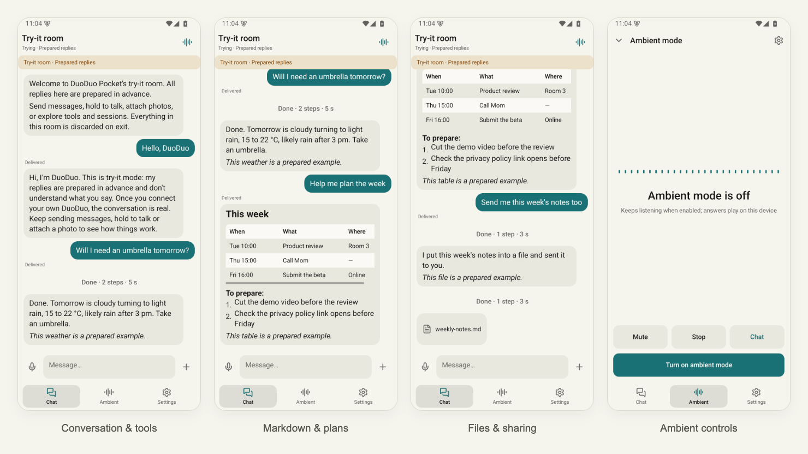
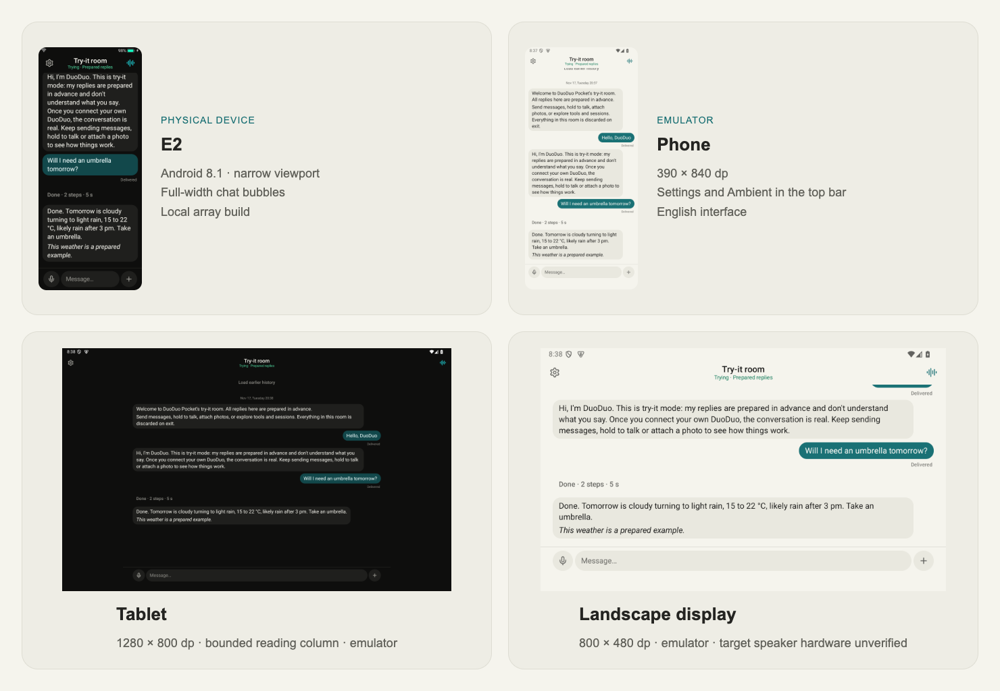

# DuoDuo Pocket for Android

English · [简体中文](README.zh-CN.md)

The native Android client for [OpenDuo Pocket](https://github.com/openduo/pocket-ios): text, voice, files and an ambient room on your own tailnet. The app shares the iOS name, pompom-and-voice-bars icon, `dev.openduo.pocket` application ID and `duoduopocket://pair` links. The reference is iOS 0.4.0 at `b9d91bb9b77a12c3e59e6f359af1e4537a4ded39`.

Built for phones, tablets and other Android devices with a display. **E2 ships as a hardware-adapter example.** Window layout and hardware integration are independent, so future display-equipped smart speakers can reuse the protocol, business logic and UI. Target smart-speaker hardware has not yet been validated.

<p align="center">
  
</p>
<p align="center"><sub>English UI with built-in Try content on an Android emulator. Replies are prepared examples; capture and playback are off.</sub></p>
<p align="center">
  
</p>
<p align="center"><sub>E2: physical-device screen capture. Phone, tablet and landscape display: emulator captures. The landscape example illustrates a reusable layout; target smart-speaker compatibility remains unverified.</sub></p>

[Download 0.4.0 Preview 3](https://github.com/openduo/pocket-android/releases/tag/v0.4.0-android.3) · [Implemented and remaining](docs/status.md) · [Device adapters](docs/devices.md) · [Architecture](docs/architecture.md) · [iOS migration gaps](docs/migration.md)

## What is implemented

- Embedded Tailscale login, authorization by QR/link, pairing, API v2 and `/live`. Recovery resamples netmon to fix a restored Wi-Fi connection leaving the node offline.
- Conversations, Markdown/tables/tools, quotes/copy/share, history, photos/files and Android import/share handoff; durable SQLite drafts, idempotent outbox and recovery receipts.
- Hold to talk, Opus voice upload/retry, ambient capture, streamed replies/read-aloud, audio focus and one shared microphone lease.
- Passport protocol 1.3 and Android BLE integration: press/audio assembly, RESULT/WORK/REPLY, quiet delivery and replay memory; [upstream differential checks and hardware limits](docs/passport.md).
- Session lists/details/notification controls, Camera2/H.264 Sight, maps/coordinates/geocoding and arrival tracking.
- English and Simplified Chinese, system/light/dark appearance, diagnostics, local notifications and a clearly labeled prepared-content Try mode.
- Shared touch/key/remote actions, editable foreground bindings, native D-pad/OK/Back navigation and an E2 REC/MARK example in Preview 3; [input guide](docs/input.md).
- Shared [pocket-rs 0.1.1](https://github.com/openduo/pocket-rs/releases/tag/v0.1.1) protocol/JNI owners, corrected media-v1 audio downlink and ongoing reply playback through screen lock.
- Compact/medium/expanded window policy, bounded reading columns, system-bar/IME insets, scrollable short-window controls and page-state restoration.

Implementation and real-service acceptance are tracked separately. The local original-package E2 build has passed one human voice-note turn with a user-confirmed audible reply, and one notification delivery with a correlated success and unique recipient record. Recognition had a wording error. These results use the earlier local E2 array build and do not establish human-speech acceptance for the public framework-audio APK. Sight has now resumed and passes actual media negotiation and native video uplink on the updated public-package E2 build; [scene recognition and sustained-rate limits](docs/sight.md) remain explicit. Full hands-free ambient conversation, physical arrivals and long-term background behavior remain unverified. Android push remains deferred. Passport has resumed in the current source and passes fixed protocol vectors on the JVM and E2 Android runtime; physical accessory acceptance is still open. Preview 3 includes these implementations, the shared Rust protocol and the lockscreen playback fix. Version alignment does not claim 1:1 parity; the [migration record](docs/migration.md) retains the remaining gaps.

## Install and connect

Preview 3 uses version code 3 and the existing public signing key, so it updates earlier public previews in place without clearing data or pairing. Android 8.0 / API 26 or later; the public APK includes **arm64-v8a and x86_64**. Google Play Services is not required. Bring your own ambient host and a Tailscale network that can reach it; there is no bundled room or account.

1. Install `Pocket.apk` from [Releases](https://github.com/openduo/pocket-android/releases).
2. Choose **Log in to Tailscale** and authorize using the link or a QR code on another device.
3. Obtain a **fresh pairing link** from your ambient host, paste or scan it, then join the room.

The earlier test package, `top.kuaner.pockete2`, and this app can coexist. Android does not transfer their private databases or AndroidKeyStore credentials across application IDs. The new app needs a fresh login/pairing; consumed one-time links cannot be reused. Existing E2 installations can instead use an explicit [same-package compatibility build](docs/devices.md#same-package-testing) signed with their original key to retain their node, pairing and data. See [connection details](docs/connection.md).

## Build

Use Rust 1.100.0, JDK 17, Android SDK 35 / Build Tools 35.0.0 / NDK 28.2.13676358 / CMake 3.22.1, Go 1.27.4 and the x/mobile version pinned in `go.mod`. Gradle wrapper 8.13 and AGP 8.13.2 are pinned. Open the repository directly in Android Studio.

```sh
git submodule update --init --recursive
rustup target add aarch64-linux-android x86_64-linux-android
export ANDROID_HOME=/path/to/android-sdk
sdkmanager 'platforms;android-35' 'build-tools;35.0.0' 'ndk;28.2.13676358' 'cmake;3.22.1'
go install golang.org/x/mobile/cmd/gomobile@v0.0.0-20260908204917-8b95e45f8d3e
go install golang.org/x/mobile/cmd/gobind@v0.0.0-20260908204917-8b95e45f8d3e
gomobile init
./gradlew :app:assembleDebug
```

The generic build uses Android framework audio. It never automatically includes local E2 firmware. A Gradle task builds the Go bridge for both ABIs; CMake builds Opus from the checksum-pinned source archive. `./gradlew :core:check` runs JVM contracts against the actual host Rust/JNI library without a device.
See [shared protocol integration](docs/rust.md).

For a locally signed release:

```sh
scripts/build-android.sh
# Output: dist/Pocket.apk
# Signing files stay outside the repository. Retain them for future updates.
# POCKET_SIGN_DIR can select a different signing directory.
```

E2 array capture is an [explicit local build option](docs/devices.md). Proprietary firmware libraries/models are excluded from source and public APKs.

## Modules and maintenance

| Module | Responsibility |
| --- | --- |
| `:core` | Android-independent models/application reducers, Rust protocol facades, request boundaries and Try transport |
| `:protocol` | Pinned pocket-rs Java/JNI interface; Rust owns room wire/framing/Ambient/retry rules |
| `:input` | Pure Java actions, input targets and paired key gestures; no Android or business dependency |
| `:ui-policy` | Pure Java window/typography policy; no business state or model-specific layout |
| `:device` | Standard Android audio/routing, capability discovery, one microphone lease and the device interface |
| `:device-e2` | E2 model/firmware detection, system-bar quirk and optional array adapter |
| `:app` (`android/`) | Android composition, persistence, controller, system services, native View pages and window containers |
| `bridge/tsbridge` | Embedded Tailscale, HTTP/WebSocket and speech transport |

Start with [architecture](docs/architecture.md), [window policy](docs/ui.md) and [localization](docs/localization.md). All application copy, native controls, accessibility descriptions, notifications and device errors share the language boundary. Source comments/tooling and public documentation use English; principal guides also have Chinese companions. Run checks relevant to a change; documentation capture does not run a regression matrix. Earlier expanded checks are retained as [historical evidence](docs/acceptance.md), with separate APK identities and limits.

```sh
python3 scripts/verify-sources.py
scripts/test-host.sh
# Alternative: ./gradlew :core:check
(cd bridge/tsbridge && go vet ./... && go test ./...)
```

Code is FSL-1.1-Apache-2.0. Dependencies retain their own licenses; see [THIRD_PARTY_NOTICES.md](THIRD_PARTY_NOTICES.md). OpenDuo names, icons and brand assets are excluded from the code license; forks must replace the brand. See the [brand notice](third_party/POCKET-IOS-NOTICE.txt). Screenshot provenance and reproduction are documented in [docs/screens](docs/screens/README.md).
