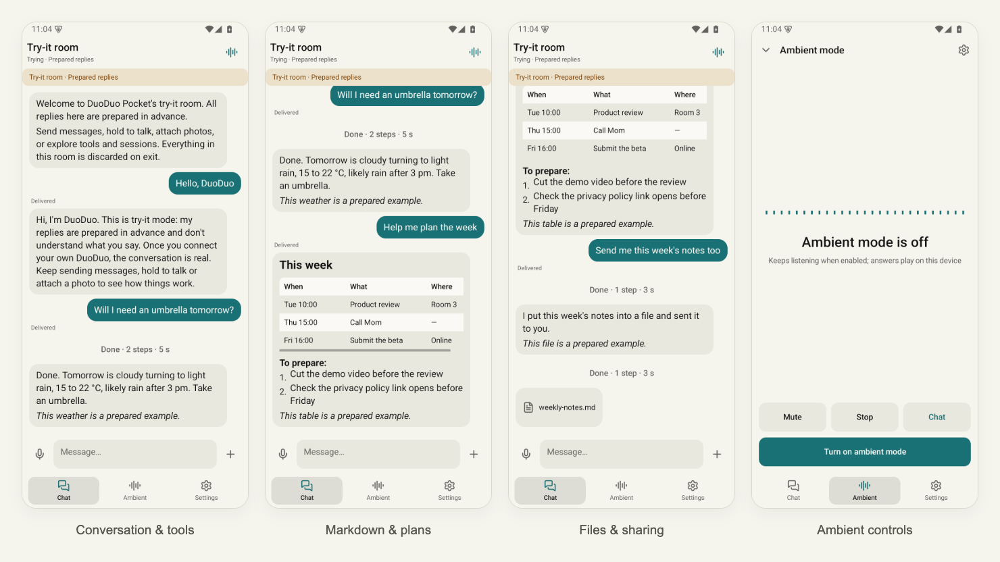
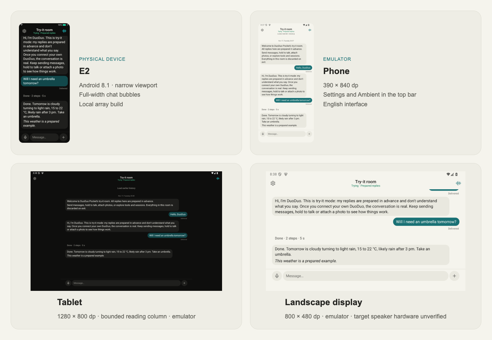

[English](README.md) · 简体中文

# 多多 · Pocket Android

[OpenDuo Pocket iOS](https://github.com/openduo/pocket-ios) 的原生 Android 实现。应用名称为 **多多 / DuoDuo Pocket**，包名为 `dev.openduo.pocket`，配对链接使用 `duoduopocket://pair`，图标沿用 OpenDuo 的绒球与声纹设计。当前对照 iOS `0.4.0`，基线 commit `b9d91bb9b77a12c3e59e6f359af1e4537a4ded39`。

项目面向手机、平板和其他带屏 Android 设备。窗口布局遵循统一 UI 策略；设备差异通过适配模块接入。

[下载 0.4.1](https://github.com/openduo/pocket-android/releases/tag/v0.4.1) · [已做与未做](docs/status.zh-CN.md) · [设备适配指南](docs/devices.zh-CN.md) · [工程架构](docs/architecture.zh-CN.md) · [与 iOS 的差异](docs/migration.md)

<p align="center"></p>
<p align="center"><sub>Android 模拟器，英文界面，内置预设体验内容；采集与播放关闭。</sub></p>
<p align="center"></p>
<p align="center"><sub>图片包含一张实体设备截图，以及手机、平板和横向窗口的模拟器截图。</sub></p>

## 当前功能

- 内嵌 Tailscale 登录、二维码/链接授权、房间配对、API v2 请求和 `/live` 实时连接；网络恢复时重新采样 netmon，修复 Wi-Fi 恢复后节点仍离线的问题。
- 文本对话、Markdown/表格/工具记录、引用/复制/分享、历史、图片/文件导入；SQLite 草稿、缓存、幂等 outbox 和导入/语音恢复。
- 按住说话、Opus 语音上传/重试、环境模式、流式回答/朗读、音频焦点与独占麦克风。
- Passport 1.3 协议与 Android BLE 接入：按压/音频组装、RESULT/WORK/REPLY、quiet 提醒与重放记忆；[上游差分验证及硬件边界](docs/passport.zh-CN.md)。
- 会话读取与详情/通知控制，Camera2/H.264 Sight、地图/坐标/地名查询及到达检测的实现。
- 中英文、浅色/深色/跟随系统、诊断、本地通知、明确标记为预设内容的 Try 模式。
- 触屏／实体键／遥控器统一动作、可修改的前台按键映射与方向／确认／返回导航；见[输入指南](docs/input.zh-CN.md)。
- 共享 [pocket-rs 0.1.1](https://github.com/openduo/pocket-rs/releases/tag/v0.1.1) 协议／JNI 所有者、正确的媒体下行音频及锁屏后继续播完当前回复。
- 聊天顶部提供设置、房间名与环境模式入口；占位文字垂直居中，触屏与实体键共用录音面板。低于 320dp 时收发气泡铺满聊天区，宽屏的消息和输入栏共用一条阅读列；见[窗口和键盘适配](docs/ui.zh-CN.md)。

实现状态与真实服务验收分开记录。当前验证边界和待办见[项目状态](docs/status.zh-CN.md)及[迁移记录](docs/migration.md)。

## 安装与首次连接

0.4.1 使用 versionCode 6 和既有公开签名，可从 0.4.0 及更早公开版本原位升级，保留数据与配对。最低 Android 8.0 / API 26；通用 APK 包含 `arm64-v8a` 和 `x86_64`。不要求 Google Play Services；没有内置房间或账号。需要自行部署的 ambient 服务和可访问主机的 Tailscale 网络。

1. 安装 Release 中的 `Pocket.apk`。
2. 选择「登录 Tailscale」，使用链接或另一台设备扫描二维码完成授权。
3. 从自己的 ambient 主机取得**新的配对链接**，粘贴或扫描后连接房间。

配对说明见[连接文档](docs/connection.md)。

## 构建

使用 Rust 1.100.0、JDK 17、Android SDK 35 / Build Tools 35.0.0 / NDK 28.2.13676358 / CMake 3.22.1、Go 1.27.4，以及 `go.mod` 固定的 x/mobile。Gradle 8.13 wrapper 和 AGP 8.13.2 已固定。Android Studio 可直接打开仓库。

```sh
git submodule update --init --recursive
rustup target add aarch64-linux-android x86_64-linux-android
export ANDROID_HOME=/path/to/android-sdk
sdkmanager 'platforms;android-35' 'build-tools;35.0.0' 'ndk;28.2.13676358' 'cmake;3.22.1'
go install golang.org/x/mobile/cmd/gomobile@v0.0.0-20260908204917-8b95e45f8d3e
go install golang.org/x/mobile/cmd/gobind@v0.0.0-20260908204917-8b95e45f8d3e
gomobile init
./gradlew :app:assembleDebug
```

标准构建使用 Android framework audio。Go bridge 会通过 Gradle 任务为两个 ABI 构建，Opus 由 CMake 从已校验的源码包构建。`./gradlew :core:check` 加载真实的宿主 Rust／JNI 库运行 JVM 契约，不需要设备。
详见[共享协议接入](docs/rust.zh-CN.md)。

需要独立签名的本地 Release：

```sh
scripts/build-android.sh
# 输出 dist/Pocket.apk；签名位于仓库外，保留它以便后续更新。
# 可通过 POCKET_SIGN_DIR 指定签名目录。
```

## 模块与维护

| 模块 | 职责 |
| --- | --- |
| `:core` | 无 Android 依赖的模型／应用 reducer、Rust 协议门面、请求边界与 Try transport |
| `:protocol` | 固定版本 pocket-rs 的 Java／JNI 接口；Rust 负责房间协议、分帧、Ambient 与重试 |
| `:input` | 纯 Java 动作、输入目标和成对按键规则；不依赖 Android 或业务 |
| `:ui-policy` | 纯 Java 窗口宽高/字号设计策略，不依赖业务与设备型号 |
| `:device:base` | 通用 Android 音频、路由、能力发现、共享麦克风 lease 与设备接口 |
| `:device:*` | 可选的硬件专用适配模块 |
| `:app` (`android/`) | Android 入口、持久化、controller、系统服务、原生 View 页面与窗口容器 |
| `bridge/tsbridge` | 内嵌 Tailscale、HTTP/WebSocket/语音传输；不参与布局 |

先看[架构](docs/architecture.zh-CN.md)、[UI 规则](docs/ui.zh-CN.md)与[国际化规范](docs/localization.zh-CN.md)。界面、原生控件、无障碍描述、通知与设备错误统一经过语言边界；源码注释/工具和公开文档以英文协作，主要指南同时提供中文。修改行为只运行相关检查，默认不扩展设备矩阵、不启动长期测试。已有扩展验收保留为[历史证据](docs/acceptance.md)。

```sh
python3 scripts/verify-sources.py
scripts/test-host.sh
# 或 ./gradlew :core:check
(cd bridge/tsbridge && go vet ./... && go test ./...)
```

代码遵循 FSL-1.1-Apache-2.0，第三方组件保留各自许可，见 [THIRD_PARTY_NOTICES.md](THIRD_PARTY_NOTICES.md)。OpenDuo 名称、图标与品牌资产不属于代码开放许可；fork 应替换品牌，见[品牌声明](third_party/POCKET-IOS-NOTICE.txt)。
