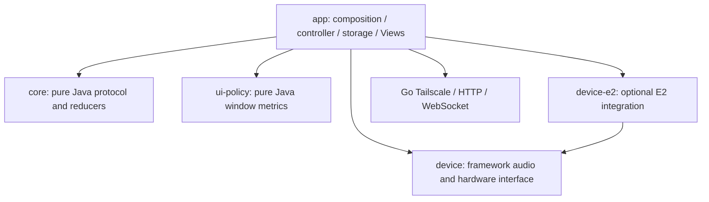

# Architecture

English · [简体中文](architecture.zh-CN.md)

Protocol, window policy and hardware integration have separate build boundaries. The app keeps its native Android View stack and shares pages across device types.

`:core` has no Android, window or hardware dependency. It owns API-v2 and live framing, message/attachment/voice values, idempotency, retry/cancellation policies, session models and arrival ledgers. Android Settings, KeyStore, SQLite and background services stay in `:app`. JVM checks use a pinned JSON implementation; Android uses its platform JSON API.

`:ui-policy` owns `AdaptiveMetrics`, which accepts current-window dp and font scale. `InsetsFrame`, `AdaptivePage`, `AdaptiveColumn`, `PageStates` and shared controls in app own insets, the IME, scrolling, column bounds and transient View state. Pages observe controller snapshots. Window changes do not change room, outbox or microphone behavior.

`:device` defines `DeviceAdapter`, standard AudioRecord/routing and capability discovery. Every input passes through the same `ExclusiveRecordingInput` lease. `:device-e2` depends only on this common hardware module. `PocketApplication` is the composition root that registers concrete adapters. OEM integrations cannot own room state or choose window geometry. A display-equipped smart speaker can start with the default adapter and add an OEM module only for actual driver differences.

`PocketController` remains the Android coordinator and single state writer. Separate bounded workers handle networking, sends, capture, camera and playback. SQLite transactions own rows/outbox/cursors and cleanup receipts. The coordinator is still large; further separation by business owner is future maintenance work. This milestone does not claim every Android business component is a separate module.

Gradle wrapper 8.13, AGP 8.13.2 and CMake provide the standard build. Go tasks declare inputs and outputs; JNI names follow the Java package; Opus comes from a checksum-pinned source archive. Signing material stays outside the repository. Generic builds contain no E2 firmware payload. CI checks source boundaries, JVM contracts, Go and a generic Debug APK. Device probes are explicit opt-in.

`scripts/check-architecture.py` checks module purity, UI/business boundaries, window-pixel ownership and OEM model detection. Gradle dependencies also prevent pure protocol code from importing Android/UI. See [devices](devices.md), [UI](ui.md) and [localization](localization.md) for extension rules.
