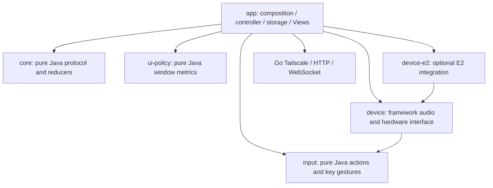

# Architecture

English · [简体中文](architecture.zh-CN.md)

Protocol, window policy and hardware integration have separate build boundaries. The app keeps its native Android View stack and shares pages across device types.

`:core` has no Android, window or hardware dependency. It owns API-v2 and live framing, message/attachment/voice values, idempotency, retry/cancellation policies, session models and arrival ledgers. Android Settings, KeyStore, SQLite and background services stay in `:app`. JVM checks use a pinned JSON implementation; Android uses its platform JSON API.

`:ui-policy` owns `AdaptiveMetrics`, which accepts current-window dp and font scale. `InsetsFrame`, `AdaptivePage`, `AdaptiveColumn`, `PageStates` and shared controls in app own insets, the IME, scrolling, column bounds and transient View state. Pages observe controller snapshots. Window changes do not change room, outbox or microphone behavior.

`:input` defines user intents, input targets and paired key-gesture reduction without Android or business dependencies. `app/input` supplies Android events, persistent overrides, permission handling and a shared action dispatcher. Touch/accessible controls use the same target; only adapters select default key bindings. Native D-pad/OK/Back navigation and visible focus are shared UI policy. See [keys and remotes](input.md).

`:device` defines `DeviceAdapter`, standard AudioRecord/routing and capability discovery. Every input passes through the same `ExclusiveRecordingInput` lease. `:device-e2` depends only on this common hardware module. `PocketApplication` is the composition root that registers concrete adapters. OEM integrations cannot own room state or choose window geometry. A display-equipped smart speaker can start with the default adapter and add an OEM module only for actual driver differences.

`PocketController` is the Android coordinator. It and the extracted state owners share one state
executor; moving a responsibility does not introduce another writer. Views still observe immutable
snapshots. SQLite transactions own rows/outbox/cursors and cleanup receipts.

| Owner | Responsibility and resource lifetime |
| --- | --- |
| `Composer` (`:core`) | Immutable draft/quote/attachment values, edit acknowledgement/generation, import handoff and interrupted-upload restoration |
| `HistoryPager` (`:core`) | Visible-row limit, bounded day scans, pagination boundary, in-flight deduplication and stale-result admission |
| `AttachmentTransfers` (`:core`) | Bounded upload/download jobs, individual cancellation scopes, room generation and main-thread result admission; Android `AttachmentStore` implements its three file-storage operations |
| `RoomLink` (`:core`) | Live generation, connector/writer queues, ping checks, copied incoming binary frames and final-control-before-close handoff |
| `VoiceNotes` (`:core`) | Recording bytes, input-source ownership, durable admission and recovery, with a store interface for SQLite |
| `OutboxSender` (`:core`) | One HTTP delivery, registered request scope, frozen voice body/surface, monotonic retry budget and its own single-worker/one-slot queue |
| `SpeechReader` (`:core`) | One read-aloud identity, incremental Opus framing, stream cancellation and admission of current-generation completion |
| `TailnetSession` (`:app`) | Authorization intent/status, login/logout action fencing and normalized native network observations |
| `Microphone` (`:app`) | Capture instance/generation, ready/stop admission and intentional shutdown; the capture thread still owns native cleanup |
| `RoomPlayback` (`:app`) | Shared output timeline, live decoder, read stream, playback generation/route/muting and drain completion |
| `ReadAloudOutput` (`:app`) | Stream-thread creation/use/release of the Android decoder, feeding the shared `SpeechPlayer` with bounded, cancellable backpressure |
| `ConversationComposer` (`app/ui`) | Editor selection/acknowledgement, attachment scrolling, import/hold controls and keyboard lifecycle; the feed retains its own rows and reading position |
| `PocketController` (`:app`) | Room admission, database transitions, foreground-service gating, permissions/audio focus, effects and snapshot publication |

Sending has an explicit durable handoff: `prepare()` registers cancellation without queuing I/O;
the controller commits `SENDING`, then calls `dispatch()`. A failed commit cancels the prepared
operation. Live/logged rows, lifecycle results and discard settle the database first, then cancel
the sender; history admission uses the same settlement path. Late HTTP/preparation/retry callbacks
cannot complete a retired operation. Retries keep the same bytes, idempotency key and surface.
The 25-second voice budget includes preparation, worker admission, HTTP and backoff. An optional
Passport budget crosses the platform boundary as a **remaining duration**, rather than an absolute
timestamp from a different clock origin. Both request timeouts and retry waits respect it.

Reading distinguishes HTTP completion from playback drain. `SpeechReader` retains the message ID
after the stream ends; `RoomPlayback` clears it only when `SpeechPlayer` has no pending audio.
Cancel replaces the current generation before cancelling its native stream, so queued work, late
packets and a retired unauthorized response cannot affect the next read. Each worker opens and
closes its own `ReadAloudOutput`; the controller never releases another thread's decoder. Initial
errors stop playback, while partial failures retain admitted audio and show the existing warning.

Uploads removed/replaced by the user cancel their own request scope; a late response cannot change
the draft. Room reset invalidates file results even after state has posted them to Android's main
thread. Cached/local previews still work without a current network credential. History scans stop
after fourteen empty days, preserve their boundary, and cannot move it forward when a late today
bootstrap arrives. Attachment transfers no longer occupy the shared ordinary HTTP pool.

These are concrete owners within existing modules, without device-specific branches or a broad
controller forwarding interface. A new input adapter still dispatches the same application action;
it does not implement retry, room state or playback.

## Stopping point and ownership audit

The 2026-11-15 follow-up stops after inspecting all remaining controller responsibilities and the
largest production classes. File length alone is not the completion criterion. The controller
still contains the application facade, immutable snapshot projection, composition/wiring and
cross-owner transaction/policy ordering. It does not duplicate the extracted mutable state.

| Inspected area | Decision and reason |
| --- | --- |
| Pairing, Try entry/exit and credential retirement | Keep application ordering together: retire old work, preserve/select storage, switch transport, then restore draft/voice and connect. A separate facade would need the same owners passed back through callbacks. |
| Live ready/row/lifecycle admission and HTTP metadata | Keep admission and database/effect ordering at the state owner. Transport generations and retry/worker lifetimes already belong to RoomLink/RoomAccess/OutboxSender/HistoryPager. |
| Ambient/hold/focus/foreground-service decisions | Keep the decisions that coordinate microphone, notes, playback, network and Android services together. Native/audio resources and wire reducers already have independent owners. |
| Sessions, Sight, arrivals and Passport entry points | Keep short application commands; SessionViewer, SightSession, ArrivalMonitor and PassportCoordinator already own their feature state. Another layer would only forward calls. |
| RoomRepository | Keep one transactional storage boundary for rows/outbox/cursors/import receipts. Splitting tables into DAOs would conceal the atomic invariants without adding independent lifetimes. |
| ConversationPage and ConversationComposer | Split editor state from feed state. Keep message cells/actions/trace rendering with the feed because they share keyed rows, expansion and scroll anchoring. |
| TryChannel, BLE link, camera capture and import coordinator | Retain each cohesive transport/resource/job owner. Prepared scripts, BLE reducers, native capture and import inbox policy are already separate. |
| Generated GraphemeData and other pure reducers/values | Retain generated data and cohesive protocol/value types; shorter files add no ownership boundary. |

Resume decomposition when a concrete feature introduces independently owned state/resources or
demonstrates coupling across these boundaries. Avoid a generic runtime/service locator, empty
modules, duplicate controller fields and large Host interfaces introduced merely to move methods.
The architecture checker also prevents direct capture/decoder/player/send-worker construction in
PocketController from creeping back in.

Gradle wrapper 8.13, AGP 8.13.2 and CMake provide the standard build. Go tasks declare inputs and outputs; JNI names follow the Java package; Opus comes from a checksum-pinned source archive. Signing material stays outside the repository. Generic builds contain no E2 firmware payload. CI checks source boundaries, JVM contracts, Go and a generic Debug APK. Device probes are explicit opt-in.

`scripts/check-architecture.py` checks module purity, UI/business boundaries, window-pixel ownership and OEM model detection. Gradle dependencies also prevent pure protocol code from importing Android/UI. See [devices](devices.md), [UI](ui.md) and [localization](localization.md) for extension rules.
