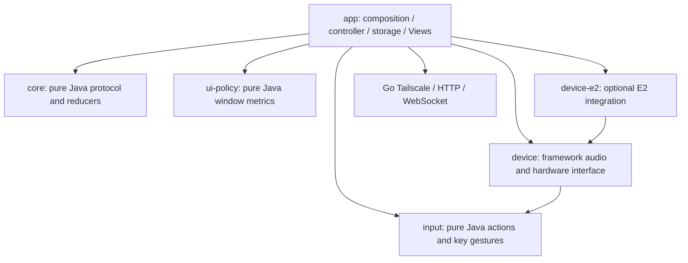

# Architecture

English · [简体中文](architecture.zh-CN.md)

Protocol, window policy and hardware integration have separate build boundaries. The app keeps its native Android View stack and shares pages across device types.

`:core` has no Android, window or hardware dependency. It owns API-v2 and live framing, message/attachment/voice values, idempotency, retry/cancellation policies, session models and arrival ledgers. Android Settings, KeyStore, SQLite and background services stay in `:app`. JVM checks use a pinned JSON implementation; Android uses its platform JSON API.

`:ui-policy` owns `AdaptiveMetrics`, which accepts current-window dp and font scale. `InsetsFrame`, `AdaptivePage`, `AdaptiveColumn`, `PageStates` and shared controls in app own insets, the IME, scrolling, column bounds and transient View state. Pages observe controller snapshots. Window changes do not change room, outbox or microphone behavior.

`:input` defines user intents, input targets and paired key-gesture reduction without Android or business dependencies. `app/input` supplies Android events, persistent overrides, permission handling and a shared action dispatcher. Touch/accessible controls use the same target; only adapters select default key bindings. Native D-pad/OK/Back navigation and visible focus are shared UI policy. See [keys and remotes](input.md).

`:device` defines `DeviceAdapter`, standard AudioRecord/routing and capability discovery. Every input passes through the same `ExclusiveRecordingInput` lease. `:device-e2` depends only on this common hardware module. `PocketApplication` is the composition root that registers concrete adapters. OEM integrations cannot own room state or choose window geometry. A display-equipped smart speaker can start with the default adapter and add an OEM module only for actual driver differences.

`PocketController` is the Android coordinator. It and the extracted state owners share one state
executor; moving a responsibility does not introduce another writer. Views still observe immutable
snapshots. SQLite transactions own rows/outbox/cursors and cleanup receipts.

| Owner | Responsibility and resource lifetime |
| --- | --- |
| `VoiceNotes` (`:core`) | Recording bytes, input-source ownership, durable admission and recovery, with a store interface for SQLite |
| `OutboxSender` (`:core`) | One HTTP delivery, registered request scope, frozen voice body/surface, monotonic retry budget and its own single-worker/one-slot queue |
| `SpeechReader` (`:core`) | One read-aloud identity, incremental Opus framing, stream cancellation and admission of current-generation completion |
| `ReadAloudOutput` (`:app`) | Stream-thread creation/use/release of the Android decoder, feeding the shared `SpeechPlayer` with bounded, cancellable backpressure |
| `PocketController` (`:app`) | Room admission, database transitions, foreground-service gating, permissions/audio focus, effects and snapshot publication |

Sending has an explicit durable handoff: `prepare()` registers cancellation without queuing I/O;
the controller commits `SENDING`, then calls `dispatch()`. A failed commit cancels the prepared
operation. Live/logged rows, lifecycle results and discard settle the database first, then cancel
the sender; history admission uses the same settlement path. Late HTTP/preparation/retry callbacks
cannot complete a retired operation. Retries keep the same bytes, idempotency key and surface.
The 25-second voice budget includes preparation, worker admission, HTTP and backoff. An optional
Passport budget crosses the platform boundary as a **remaining duration**, rather than an absolute
timestamp from a different clock origin. Both request timeouts and retry waits respect it.

Reading distinguishes HTTP completion from playback drain. `SpeechReader` retains the message ID
after the stream ends; the controller clears it only when `SpeechPlayer` has no pending audio.
Cancel replaces the current generation before cancelling its native stream, so queued work, late
packets and a retired unauthorized response cannot affect the next read. Each worker opens and
closes its own `ReadAloudOutput`; the controller never releases another thread's decoder. Initial
errors stop playback, while partial failures retain admitted audio and show the existing warning.

These are concrete owners within existing modules, without device-specific branches or a broad
controller forwarding interface. A new input adapter still dispatches the same application action;
it does not implement retry, room state or playback. Connection/reconnect, draft/attachment/history
orchestration and ambient capture/output coordination remain in the controller. Further extraction
should follow their actual state/resource ownership rather than a controller line-count target.

Gradle wrapper 8.13, AGP 8.13.2 and CMake provide the standard build. Go tasks declare inputs and outputs; JNI names follow the Java package; Opus comes from a checksum-pinned source archive. Signing material stays outside the repository. Generic builds contain no E2 firmware payload. CI checks source boundaries, JVM contracts, Go and a generic Debug APK. Device probes are explicit opt-in.

`scripts/check-architecture.py` checks module purity, UI/business boundaries, window-pixel ownership and OEM model detection. Gradle dependencies also prevent pure protocol code from importing Android/UI. See [devices](devices.md), [UI](ui.md) and [localization](localization.md) for extension rules.
