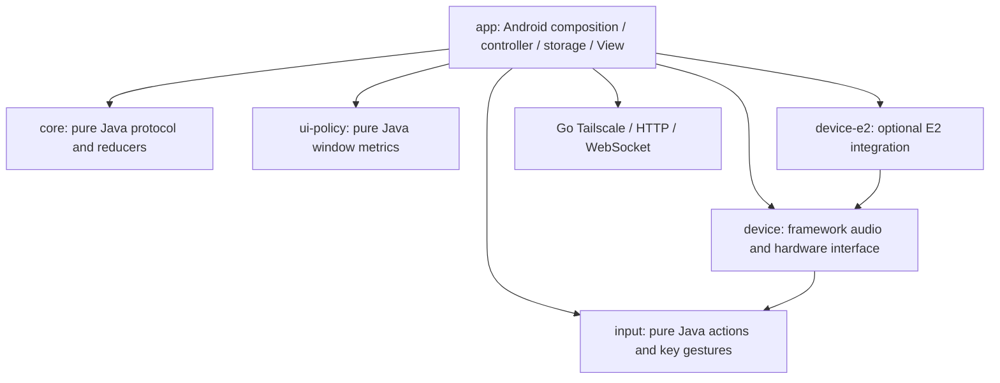

# 工程架构

业务协议、窗口策略和硬件适配分别建立构建边界。沿用原生 View，避免为了模块化重写交互或复制页面。

`:core` 不依赖 Android、窗口或硬件，包含 API v2、live/消息/附件/语音 framing、幂等/重试/取消、会话与位置 ledger 等纯模型。Android 的 `Settings`、KeyStore、SQLite、后台服务留在 app。JSON 在 JVM 使用固定的 `org.json`，在 Android 使用系统实现。

`:ui-policy` 的 `AdaptiveMetrics` 只接受当前窗口 dp 和字号比例。app 中 `InsetsFrame`、`AdaptivePage`、`AdaptiveColumn`、`PageStates` 和共享控件负责系统栏、IME、滚动、列宽和短期 View 状态。页面渲染 controller snapshot；尺寸变化不改变房间、outbox 或麦克风逻辑。

`:input` 定义统一动作、输入目标和按键边沿规则，不依赖 Android 或业务。`app/input` 管理 Android 事件、本地映射、权限和共享动作分发；触屏／无障碍控件也使用同一个目标，默认键位只由适配器决定。公共 UI 保留方向／确认／返回导航及明显焦点，见[按键与遥控器](input.zh-CN.md)。

`:device` 定义 `DeviceAdapter`，提供标准 `AudioRecord`、路由和能力发现。所有实现都经过同一个 `ExclusiveRecordingInput` lease，不能绕过它同时开启麦克风。`:device-e2` 是单向依赖通用接口的案例；`PocketApplication` 是唯一注册具体设备的组合入口。OEM 不能反向引用业务状态，也不决定窗口大小。智能音箱可先走默认适配器，只有厂商阵列/系统栏等差异才新增模块。

`PocketController` 是 Android 应用层的单 writer，负责协调独立网络、发送、capture、camera 和播放队列；持久化事务拥有行/outbox/cursor 与待清理 receipt。`VoiceNotes` 已拆到 `:core`，拥有录音字节、输入所有权、持久化交接和恢复，通过存储接口连接 SQLite；controller 在同一个 state executor 上协调 capture，不再重复保存录音状态。连接／outbox／音频协调仍可沿这些 owner 继续拆分；本阶段不宣称已把全部 Android 业务拆成独立模块。

构建使用 Gradle wrapper 8.13、AGP 8.13.2 和 CMake。Go bridge 通过有输入/输出声明的任务构建，JNI 包名与 Java 一致，Opus 的固定源码压缩包经过 SHA-256 校验。Release 签名不进入仓库，公共构建无 E2 私有 payload。CI 运行静态边界、纯 Java 契约、Go 检查和通用 Debug APK 构建；设备探针保持显式 opt-in。

`scripts/check-architecture.py` 检查模块纯度、UI/业务、窗口像素和 OEM 型号边界。Gradle 模块同时阻止纯协议误引用 Android 或 UI。新增设备见[设备指南](devices.md)，新增布局规则见[UI 指南](ui.md)。
