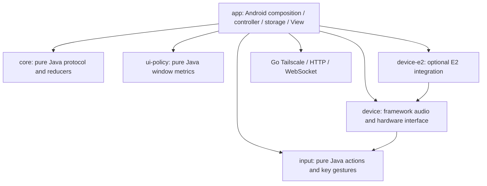

# 工程架构

业务协议、窗口策略和硬件适配分别建立构建边界。沿用原生 View，避免为了模块化重写交互或复制页面。

`:core` 不依赖 Android、窗口或硬件，包含 API v2、live/消息/附件/语音 framing、幂等/重试/取消、会话与位置 ledger 等纯模型。Android 的 `Settings`、KeyStore、SQLite、后台服务留在 app。JSON 在 JVM 使用固定的 `org.json`，在 Android 使用系统实现。

`:ui-policy` 的 `AdaptiveMetrics` 只接受当前窗口 dp 和字号比例。app 中 `InsetsFrame`、`AdaptivePage`、`AdaptiveColumn`、`PageStates` 和共享控件负责系统栏、IME、滚动、列宽和短期 View 状态。页面渲染 controller snapshot；尺寸变化不改变房间、outbox 或麦克风逻辑。

`:input` 定义统一动作、输入目标和按键边沿规则，不依赖 Android 或业务。`app/input` 管理 Android 事件、本地映射、权限和共享动作分发；触屏／无障碍控件也使用同一个目标，默认键位只由适配器决定。公共 UI 保留方向／确认／返回导航及明显焦点，见[按键与遥控器](input.zh-CN.md)。

`:device` 定义 `DeviceAdapter`，提供标准 `AudioRecord`、路由和能力发现。所有实现都经过同一个 `ExclusiveRecordingInput` lease，不能绕过它同时开启麦克风。`:device-e2` 是单向依赖通用接口的案例；`PocketApplication` 是唯一注册具体设备的组合入口。OEM 不能反向引用业务状态，也不决定窗口大小。智能音箱可先走默认适配器，只有厂商阵列/系统栏等差异才新增模块。

`PocketController` 是 Android 应用协调层。它与拆出的状态组件共用一个 state executor，拆分职责不会
增加房间状态的 writer；页面仍只观察不可变 snapshot。SQLite 事务拥有行／outbox／cursor 与待清理 receipt。

| 所有者 | 职责与资源生命周期 |
| --- | --- |
| `VoiceNotes`（`:core`） | 录音字节、输入来源所有权、持久化交接与恢复，通过存储接口连接 SQLite |
| `OutboxSender`（`:core`） | 一次 HTTP 发送、已注册的请求范围、固定语音字节与发送参数、单调时钟重试预算，以及专属单线程／单等待位队列 |
| `SpeechReader`（`:core`） | 一次朗读的消息身份、Opus 增量分包、流取消与当前请求结果接纳 |
| `ReadAloudOutput`（`:app`） | 在流线程创建／使用／释放 Android 解码器，通过可取消的有界背压接入共享 `SpeechPlayer` |
| `PocketController`（`:app`） | 房间准入、数据库状态转换、前台服务、权限与音频焦点、业务副作用及 snapshot 发布 |

发送有明确的持久化交接：`prepare()` 先注册取消能力，但不排入 I/O；controller 提交 `SENDING` 后
才调用 `dispatch()`。数据库提交失败就取消准备中的请求。实时／历史日志、生命周期回执及丢弃操作
先更新数据库，再取消已结束的发送；历史入库也走同一条结算路径。旧 HTTP、准备任务和重试回调不能
结束新请求。重试沿用同一份字节、幂等键和发送参数。语音 25 秒总预算涵盖准备、等待 worker、HTTP
与退避。Passport 传入的是**剩余时长**，不跨层传递不同单调时钟基准上的绝对时间；请求超时和重试
等待同时受其约束。

朗读区分 HTTP 结束与播放排空。`SpeechReader` 在流结束后保留消息 ID，controller 等 `SpeechPlayer`
没有待播音频后才清除。取消先撤销当前请求，再停止其原生流，因此排队任务、迟到音频及旧请求的
未授权响应不能影响下一次朗读。每个 worker 自己创建和关闭 `ReadAloudOutput`，controller 不跨线程
释放它的解码器。首包前失败会停止播放；部分失败保留已接纳的音频并显示已有的不完整提示。

这些组件在既有模块内拥有真实状态和资源，不需要设备分支或大而全的 controller 转发接口。新增输入
适配仍只分发统一动作，无需实现房间、重试或播放逻辑。连接／重连、草稿／附件／历史编排和环境音频
协调仍在 controller；后续继续沿实际状态及资源所有权拆分，不以文件行数作为完成标准。

构建使用 Gradle wrapper 8.13、AGP 8.13.2 和 CMake。Go bridge 通过有输入/输出声明的任务构建，JNI 包名与 Java 一致，Opus 的固定源码压缩包经过 SHA-256 校验。Release 签名不进入仓库，公共构建无 E2 私有 payload。CI 运行静态边界、纯 Java 契约、Go 检查和通用 Debug APK 构建；设备探针保持显式 opt-in。

`scripts/check-architecture.py` 检查模块纯度、UI/业务、窗口像素和 OEM 型号边界。Gradle 模块同时阻止纯协议误引用 Android 或 UI。新增设备见[设备指南](devices.md)，新增布局规则见[UI 指南](ui.md)。
