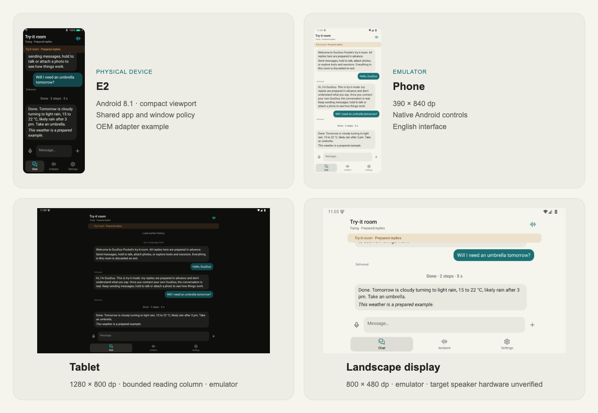

# Device support and hardware adapters

English · [简体中文](devices.zh-CN.md)

Android framework capabilities are the default. E2 ships as a concrete adapter example. Screen dimensions and hardware identity are independent: phones, tablets and landscape display devices share the window policy and business pages.

<p align="center"></p>

## Current support

| Area | Implementation | Verification boundary |
| --- | --- | --- |
| System | Android 8.0 / API 26+, no Google Play Services requirement | Limited representative checks; all OEMs are not covered |
| CPU | arm64-v8a and x86_64 | No ARMv7/32-bit build; some older smart speakers need another ABI |
| Windows | Compact <600dp, medium 600–839dp, expanded >=840dp; short-window, IME and inset handling | Current representative captures/checks and earlier E2 ~259dp evidence are identified separately |
| Framework audio | AudioRecord 16kHz mono PCM16, MIC fallback when communication input is unsupported, system AEC when available | Actual drivers and acoustic quality need target-device verification |
| Camera/location/Bluetooth | Optional manifest features, runtime capability/permission/error handling | No camera means no Sight/QR capture; pairing can use a pasted link. Arrivals need a location source and geocoder |
| Display-equipped smart speakers | Reusable standard audio/UI; OEM adapters can add specialized capture | No target speaker hardware accepted; far-field, AEC, background and remote-only interaction remain open |

## E2 example

<p align="center"></p>
<p align="center"><sub>Physical E2, API 27, existing display configuration, English UI and prepared Try content. No actual room, microphone or camera was used for these documentation captures.</sub></p>

`E2DeviceAdapter` matches API27 and model `E2 AI Recorder`. It declares the firmware's system-icon quirk. Array capture additionally requires firmware 04319 and locally supplied libraries/models. A generic APK without that payload falls back to standard Android input. Its acoustic performance on E2 is unverified; earlier native-array evidence belongs to the local firmware build and the old application ID.

Array Java/JNI adapter source is public. Proprietary firmware libraries/models are excluded from the repository and public APK. Inclusion requires an explicit local property; no build automatically discovers `.build/firmware`:

```sh
scripts/build-android.sh -Pe2FirmwareDir=/absolute/path/to/local/firmware
```

Expected local structure:

```text
firmware/
  assets/e2-array-models.zip
  lib/arm64-v8a/… libraries for firmware 04319 …
```

This local build uses the same application ID as the generic app. Keep the proprietary result out of public Releases. Building without the property returns to the generic payload. `scripts/build-e2-adapter.sh` writes only to an ignored build directory. Local array JNI compilation passed; prior physical capture evidence is retained in [acceptance](acceptance.md).

## Adapter contract

`DeviceAdapter` exposes matching, an input factory and the system-bar quirk. `AndroidDeviceAdapter` is the default. `DeviceRuntime.install` registers ordered adapters only in `PocketApplication.onCreate`; unmatched hardware uses Android. `DeviceCapabilities` discovers microphone, camera, location, geocoder and Bluetooth independently; diagnostics show the result. A feature flag is separate from permission and current driver availability.

The factory runs on the capture owner thread after the global microphone lease is acquired. Returned `RecordingInput` implementations must release native resources on that owner, support bounded reads and clean up on stop/failure. Hardware code cannot access room tokens, outbox, controller or window dimensions. Output currently uses shared Android AudioTrack/AudioManager; there is no speculative vendor playback interface.

To add an OEM integration, create `:device-<vendor>` depending on `:device`, implement or extend `AndroidDeviceAdapter`, and register it in the app composition root. Add a short check for the actual driver difference. Layout still goes through `AdaptiveMetrics`. Existing Camera2/MediaCodec, LocationManager and thermal adapters continue to use framework APIs.

## Bringing up a smart speaker

First establish Android/API/ABI, install permission, AudioRecord/AudioTrack, authorization and whether navigation is touch, remote or physical keys. Some locked-down devices restrict third-party recording or background work. Default foreground use needs no root, system signing, replacement launcher or density change.

Once hardware is available, verify login/room online, natural voice upload and audible replies first. Add full-duplex/array and background checks only as required by that device. Wake words, kiosk/always-on launcher behavior, system-level background execution, OEM AEC and a dedicated no-touch experience are not implemented by this milestone. The landscape screenshot shows layout reuse, not completed speaker-hardware acceptance.
