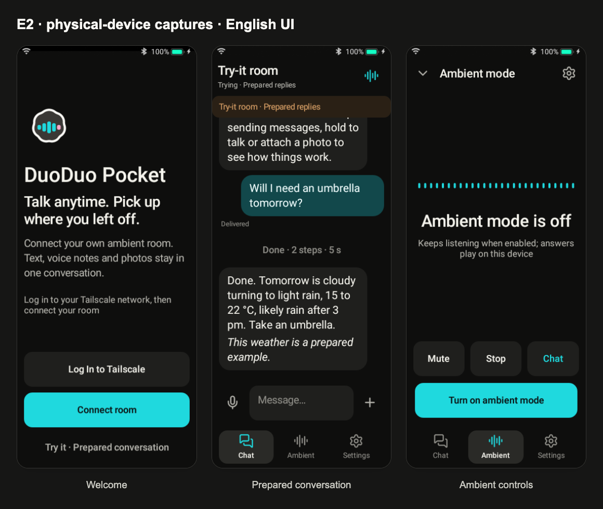

# Device support and hardware adapters

English · [简体中文](devices.zh-CN.md)

Android framework capabilities are the default. E2 ships as a concrete adapter example. Screen dimensions and hardware identity are independent: phones, tablets and landscape display devices share the window policy and business pages.

<p align="center"></p>

## Current support

| Area | Implementation | Verification boundary |
| --- | --- | --- |
| System | Android 8.0 / API 26+, no Google Play Services requirement | Limited representative checks; all OEMs are not covered |
| CPU | arm64-v8a and x86_64 | No ARMv7/32-bit build; some older smart speakers need another ABI |
| Windows | Compact <600dp, medium 600–839dp, expanded >=840dp; short-window, IME and inset handling | Current representative captures/checks and earlier E2 ~259dp evidence are identified separately |
| Framework audio | AudioRecord 16kHz mono PCM16, MIC fallback when communication input is unsupported, system AEC when available | Actual drivers and acoustic quality need target-device verification |
| Camera/location/Bluetooth | Optional manifest features, runtime capability/permission/error handling | No camera means no Sight/QR capture; pairing can use a pasted link. Arrivals need a location source and geocoder |
| Display-equipped smart speakers | Reusable standard audio/UI; OEM adapters can add specialized capture | E11 screen and D-pad UI checked; room audio, physical voice key, far-field, AEC and background remain open |

## E2 example

<p align="center"></p>
<p align="center"><sub>Physical E2, API 27, existing display configuration, English UI and prepared Try content. No actual room, microphone or camera was used for these documentation captures.</sub></p>

`E2DeviceAdapter` matches API27 and model `E2 AI Recorder`. It declares the firmware's system-icon quirk. Firmware 04319 requires locally supplied array libraries/models for its built-in microphone. Standard Android input opens on this firmware but supplies no microphone signal. A generic APK therefore reports that built-in input is unavailable instead of uploading invalid audio; a selected headset microphone retains the standard route. Use the local array build on E2.

Array Java/JNI adapter source is public. Proprietary firmware libraries/models are excluded from the repository and public APK. Inclusion requires an explicit local property; no build automatically discovers `.build/firmware`:

```sh
scripts/build-android.sh -Pe2FirmwareDir=/absolute/path/to/local/firmware
# Local-only output, same public package and signing key:
adb -s YOUR_DEVICE_SERIAL install -r dist/Pocket-E2.apk
```

Expected local structure:

```text
firmware/
  assets/e2-array-models.zip
  lib/arm64-v8a/… libraries for firmware 04319 …
```

This local build uses the same application ID and signing key as the generic app, preserving its data and pairing. It writes `dist/Pocket-E2.apk` without overwriting `dist/Pocket.apk`. Keep the proprietary result out of public Releases and leave E2 on its adapted build. Building without the property produces the generic payload for other hardware. `scripts/build-e2-adapter.sh` writes only to an ignored build directory. The restored public-identity E2 passes local calibration capture and 34 bounded input assertions; see [current audio evidence](audio.md#e2-built-in-capture).

## Same-package testing

The current E2 uses the public `dev.openduo.pocket` identity and the local array APK above. Keep
that identity, signature, pairing and node; do not reinstall the retired legacy app. The following
compatibility option documents earlier installations only.

An existing `top.kuaner.pockete2` installation can receive an explicit, same-signature compatibility
build. This reuses its login, room pairing, cache and Tailscale node instead of registering another
device. The Java namespace and shared application code remain `dev.openduo.pocket`; `AppIdentity`
selects the original preference/database names, AndroidKeyStore alias and node hostname at build
time. The tailnet state stays in the same no-backup directory. File-provider authorities follow
the application ID.

```sh
POCKET_LEGACY_IDENTITY=1 scripts/build-android.sh
adb -s YOUR_DEVICE_SERIAL install -r dist/PocketLegacy.apk
```

The original signing key and password must exist in `$HOME/.local/share/pocket-e2/signing`
(`pocket-e2.p12`, alias `pocket-e2`, and `password`). `POCKET_E2_SIGN_DIR` can select another
directory. The build fails if this key is absent; it never generates a replacement legacy key.
Use `install -r`, without uninstalling or clearing data. This is an in-place update, not a
cross-package credential transfer.

For an E2 that used the local array integration, append
`-Pe2FirmwareDir=/absolute/path/to/local/firmware` to the same command. That proprietary result
is local-only and writes `dist/PocketLegacy-E2.apk`. Without `POCKET_LEGACY_IDENTITY`, the build
keeps the public `dev.openduo.pocket` identity: generic output is `dist/Pocket.apk`, and explicit
array output is `dist/Pocket-E2.apk`. No firmware is included unless explicitly requested.

The original-package readiness check is read-only and does not record, play, capture or send:

```sh
ANDROID_SERIAL=YOUR_DEVICE_SERIAL \
POCKET_LEGACY_IDENTITY=1 \
POCKET_TEST_SERVICE_READINESS_ONLY=1 \
scripts/test-device.sh
```

Only targeted service checks are supported on the paired legacy installation; an unfiltered
historical suite is refused. See [service acceptance](service-acceptance.md) for the pending
microphone, Sight and explicitly selected notification paths.

## Adapter contract

`DeviceAdapter` exposes matching, an input factory and the system-bar quirk. `AndroidDeviceAdapter` is the default. `DeviceRuntime.install` registers ordered adapters only in `PocketApplication.onCreate`; unmatched hardware uses Android. `DeviceCapabilities` discovers microphone, camera, location, geocoder and Bluetooth independently; diagnostics show the result. A feature flag is separate from permission and current driver availability.

The factory runs on the capture owner thread after the global microphone lease is acquired. Returned `RecordingInput` implementations must release native resources on that owner, support bounded reads and clean up on stop/failure. Hardware code cannot access room tokens, outbox, controller or window dimensions. Output currently uses shared Android AudioTrack/AudioManager; there is no speculative vendor playback interface.

To add an OEM integration, create `:device-<vendor>` depending on `:device`, implement or extend `AndroidDeviceAdapter`, and register it in the app composition root. Add a short check for the actual driver difference. Layout still goes through `AdaptiveMetrics`. Existing Camera2/MediaCodec, LocationManager and thermal adapters continue to use framework APIs.

## Bringing up a smart speaker

On 2026-11-15 the earlier signed layout APK (`a58e337ac2db16dc6d3622df69a00d02743a615cff243589ac9a2c607ec16cbf`) was installed in place on an AIUniBOX E11 (Android 11, ARM64, 1280×720 px at 213 dpi, approximately 961×541dp). Its onboarding, Try conversation and Ambient screens occupied the actual window; D-pad/OK navigated from onboarding to Try and between the conversation and Ambient pages. These were prepared Try responses with Ambient off. The E11 showed `network: Failed`, so no room login, pairing, audio capture, camera upload or audible reply was accepted. Captures are kept in ignored `.build/acceptance/ui/`, not public screenshots. The later general layout revision in [UI validation](ui.md#validation) has not been installed on this device.

The kernel reports `adc-keys` with volume up/down and `KEY_MICMUTE`, and a separate remote input with `KEY_VOICECOMMAND`. On this firmware Android maps the latter to `VOICE_ASSIST` and consumes an injected event before it reaches Pocket's foreground Activity; an injected `MEDIA_RECORD` event does reach the Activity. We did not identify the user's physical voice button from an actual press, so no OEM key default or system remapping has been applied. A real key event capture is needed before deciding how to route that button. No density, launcher or system key layout was changed.

First establish Android/API/ABI, install permission, AudioRecord/AudioTrack, authorization and whether navigation is touch, remote or physical keys. Some locked-down devices restrict third-party recording or background work. Default foreground use needs no root, system signing, replacement launcher or density change.

Foreground key learning, D-pad/OK/Back navigation and the E2 REC/MARK example are now implemented in the current source; see [keys and remotes](input.md). Firmware-consumed keys remain outside the app.

For the E11, verify login/room online, natural voice upload and audible replies before full-duplex/array and background checks. Wake words, kiosk/always-on launcher behavior, system-level background execution and OEM AEC remain open. The shared foreground no-touch input path is implemented, with bounded E2 event-delivery evidence. The landscape screenshot shows layout reuse, while the separate E11 inspection covers its actual display and D-pad route.
