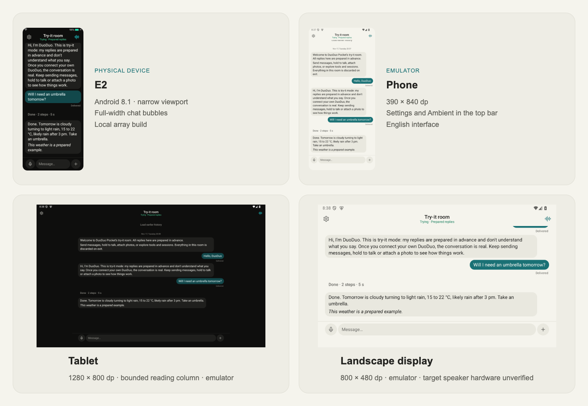
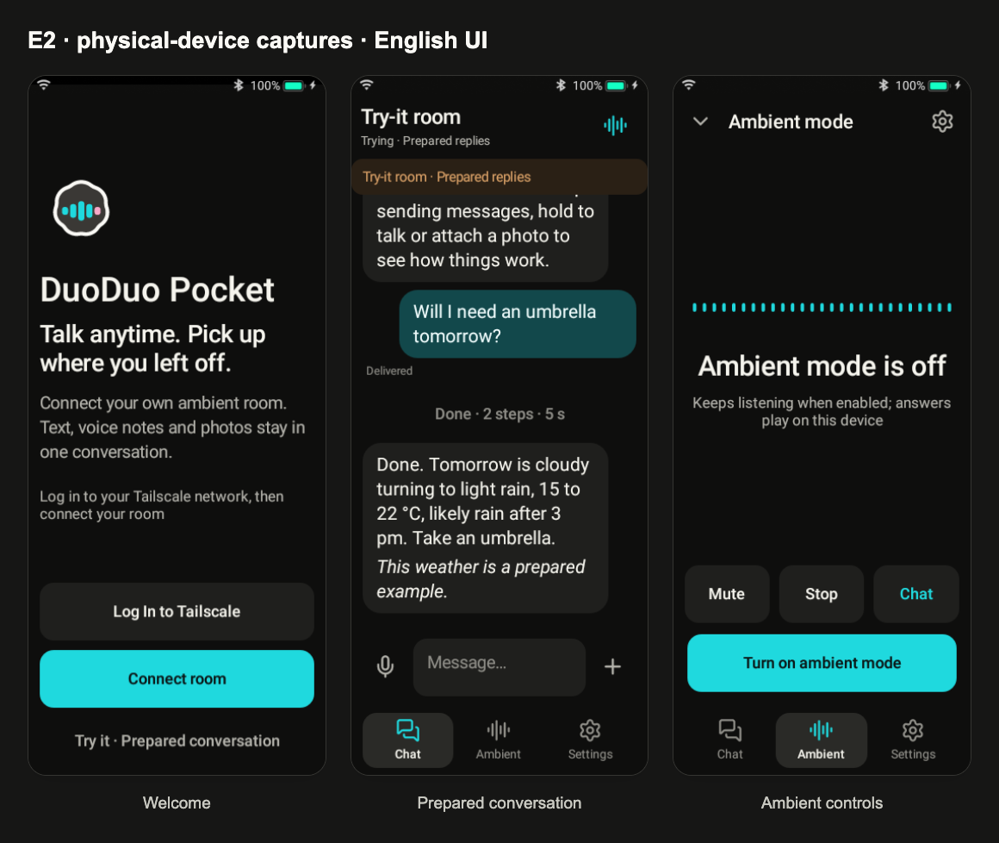

# 多设备与硬件适配

项目以 Android 系统能力为默认实现，E2 作为一个可随源码发布的适配案例。屏幕尺寸与硬件型号独立：小手机、平板和横向音箱窗口共享同一套布局策略，不会按型号复制业务页面。

<p align="center"></p>

## 支持范围

| 项目 | 当前范围 | 验证边界 |
| --- | --- | --- |
| 系统 | Android 8.0 / API 26 起，不依赖 Google Play Services | 当前发布只做有限代表性验证；不能覆盖所有 OEM |
| CPU | arm64-v8a、x86_64 | 不包含 32 位 ARM/x86；不少旧音箱为 ARMv7，需要另行补 ABI |
| 窗口 | `<600dp`、`600–839dp`、`>=840dp`；短窗口、Insets、IME、滚动与宽度上限 | E2 约259dp旧包有历史证据；新版验证见 status |
| 标准音频 | AudioRecord 16kHz/mono/PCM16；communication 不可用时尝试 MIC；可用时开启系统 AEC | 厂商支持、声学效果和可听回复须在实际设备确认 |
| 相机/定位/蓝牙 | manifest 标为可选；运行时发现能力，原有失败/权限说明保留 | 没有相机不能 Sight/扫码，可粘贴配对；没有定位源不能自动到达检测 |
| 带屏智能音箱 | 标准输入和触屏界面可复用，专有驱动可新增适配模块 | 未拿到目标硬件；阵列、AEC、后台、遥控器/远场唤醒均未验收 |

## 设备接口

`device/.../DeviceAdapter` 暴露型号匹配、输入工厂和系统栏例外。`AndroidDeviceAdapter` 是默认实现；`DeviceRuntime.install` 只在 `PocketApplication.onCreate` 注册有序适配器，未匹配时回到 Android。业务与 UI 通过通用接口消费设备行为。`DeviceCapabilities` 独立发现麦克风/相机/定位/geocoder/蓝牙，诊断页可查看；能力不等同权限，也不保证当前驱动可用。

输入工厂在 capture owner 线程、取得全局 microphone lease 后调用，返回实现 `RecordingInput` 的输入。`start/read/stop/close` 必须遵守 owner 线程与资源释放约定；停止/异常必须释放引擎，`read` 应有有限返回时间。实现只能提供硬件行为，不能触碰 room token、outbox、controller 或窗口尺寸。输出目前共享 Android AudioTrack/AudioManager，暂未抽象厂商私有播放引擎。

新增专有设备时：建立依赖 `:device` 的 `:device-<vendor>` Android library，实现或继承 `AndroidDeviceAdapter`，在 app composition root 注册，并按该设备的真实能力编写短验证。尺寸仍通过 `AdaptiveMetrics`，不写入 adapter。已有标准相机/MediaCodec、LocationManager 和热状态继续通过系统 API，尚无需求时不建立空的厂商抽象。

## E2 案例

<p align="center"></p>

英文界面、预设体验内容，未采集麦克风/相机或发送真实房间消息。

`E2DeviceAdapter` 只匹配 Android API27 的 `E2 AI Recorder`；保留该固件无法绘制深色系统图标的例外。阵列输入还要求固件 04319 指纹与本地 native 库/模型存在。未提供阵列 payload 的通用 APK 走标准 Android 输入；**该路径在 E2 上的声学效果未验证**，不等同已验证的私有阵列路径。

阵列 Java/JNI adapter 源码可公开，厂商库和模型不属于项目可公开分发内容。只有显式传入属性时才打包，不会自动读取 `.build/firmware`：

```sh
scripts/build-android.sh -Pe2FirmwareDir=/absolute/path/to/local/firmware
```

本地目录结构：

```text
firmware/
  assets/e2-array-models.zip
  lib/arm64-v8a/… vendor libraries for firmware 04319 …
```

本地 E2 包与通用包使用相同应用 ID，请不要把带私有固件的产物上传公共 Release。去掉属性后重新构建即可回到通用版本。`scripts/build-e2-adapter.sh` 只向 ignored 模块 build 目录写产物。历史 E2 验证保存在[验收记录](acceptance.md)，不将其自动归给改包名后的 APK。

## 原包覆盖测试

已有 `top.kuaner.pockete2` 安装时，可以显式生成同签名兼容包，复用登录、房间配对、缓存和
Tailscale 节点，无需再注册设备。Java namespace 和共用应用代码仍为 `dev.openduo.pocket`；
`AppIdentity` 在构建时集中选择原来的 preferences/数据库名、AndroidKeyStore alias 和节点名，
tailnet 状态继续使用同一个 no-backup 目录，文件 provider 的 authority 跟随实际包名。

```sh
POCKET_LEGACY_IDENTITY=1 scripts/build-android.sh
adb -s YOUR_DEVICE_SERIAL install -r dist/PocketLegacy.apk
```

必须保留原签名目录 `$HOME/.local/share/pocket-e2/signing` 中的 `pocket-e2.p12`（alias 为
`pocket-e2`）与 `password`，也可通过 `POCKET_E2_SIGN_DIR` 指定目录。缺少原签名时构建会失败，
不会生成新的兼容包签名。只用 `install -r` 覆盖，不能先卸载或清数据；这是原地更新，不是跨包凭据迁移。

原机使用本地 E2 阵列时，在上述构建命令后追加
`-Pe2FirmwareDir=/absolute/path/to/local/firmware`，带私有固件的产物仅留本地。
不设置 `POCKET_LEGACY_IDENTITY` 时仍构建公开包 `dev.openduo.pocket`，输出 `dist/Pocket.apk`；
只有显式传入固件属性才包含固件。

以下原包前置检查只读状态，不录音、不播放、不采集相机、不发送内容：

```sh
ANDROID_SERIAL=YOUR_DEVICE_SERIAL \
POCKET_LEGACY_IDENTITY=1 \
POCKET_TEST_SERVICE_READINESS_ONLY=1 \
scripts/test-device.sh
```

已配对旧包只支持指定的服务短检查，不指定范围的历史全量套件会被拒绝。
实际麦克风、Sight 和明确指定收件目标的通知验收见[真实服务指南](service-acceptance.zh-CN.md)。

## 智能音箱后续接入

先确认 Android 版本、ABI、可安装权限、AudioRecord/AudioTrack 与系统授权可用；不少封闭设备限制第三方录音或后台进程。确认设备有触屏还是遥控器/物理键，再决定是否补专门输入导航。默认前台使用不需要常驻 launcher、root、系统签名或修改设备密度。

硬件到位后先检查登录/房间在线、实际人声录音上传与可听回答，再按需要验证全双工回声/厂商阵列及后台恢复。远场唤醒词、开机自启 kiosk、常驻系统服务、厂商系统级 AEC 和无触摸专用体验当前都未实现，不因布局可适配就宣称支持。
