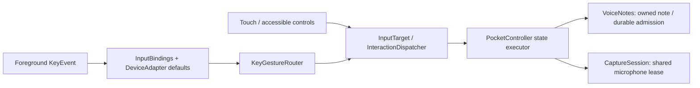

# Keys, remotes and shared actions

English · [简体中文](input.zh-CN.md)

Touch, accessibility activation, keyboard controls and foreground hardware keys use the same
application actions. E2 is the included hardware example; the business layer has no E2 model,
Android key-code or window-size branch. Preview 3 includes this implementation.

## What demonstrates flexibility

The acceptance criterion is replacing an input source or device without forking room behavior.
The E2 check exercised the shared capabilities as well as its defaults:

| Change | Extension point | Evidence |
| --- | --- | --- |
| Add an unfamiliar foreground key | Learn a per-device binding in Settings | A received F3 event was learned and assigned Open settings using D-pad/OK; it then opened the page |
| Change a key's interaction style | Select another `InputAction` | REC changed from toggle to hold/release through a saved override, without a source change |
| Switch between touch and hardware | Shared `InputTarget` and owned `VoiceNotes` | Touch cleanup could not end a hardware-owned note; explicit Send/Cancel still applies to the current note |
| Use a display without touch | Native focus navigation and shared sheets | D-pad/OK/Back reached settings and completed key learning/action selection |
| Add another OEM device | `DeviceAdapter.keyAction` plus optional driver implementation | Enforced source/module boundary; actual target-speaker hardware is still pending |

The last row is an architectural extension path, not a second device acceptance claim. An input
adapter does not have its own room state, upload queue or microphone. The E2 key names below
illustrate this shared design.

## Using E2

| Control | Default behavior |
| --- | --- |
| REC (`F1`, Android code 131) | Press and release to start a voice note; press again to send |
| MARK (`F2`, Android code 132) | Cancel the current recording; otherwise stop speech playback |
| On-screen voice control | Hold and release to send, move outside to cancel; a stationary control shows recording animation, duration and release hint |
| Recording panel | Explicit Send and Cancel actions for hardware/OK/accessibility recording; hidden during a touch hold |

Recording switches to the conversation page and shows preparation, duration and the shared
recording state. Touch uses simple animated bars after capture starts, independent of microphone
amplitude; no directional send gesture is needed. OK/accessibility activation starts or sends.
Recording works while the composer is in text mode without discarding its draft.
The E2 defaults come from the device adapter and the documented firmware key mapping, not from
the room protocol. Generic Android devices additionally default `MEDIA_RECORD` to voice toggle.

Open **Settings → Keys & remotes → Add or change a key**, press the desired key, then choose its
action. Bindings are stored per Android input-device descriptor, key code and scan code. They
survive app restarts and override device defaults. The binding list lets you reassign, remove or
disable an action. Removing an override restores the adapter default. A scan-code-only event can
be learned if Android supplies one.

Available actions: hold/release voice, start/send voice toggle, send the current recording,
cancel/stop, ambient toggle, reply mute/unmute, read latest reply, open conversation, open settings
and do nothing. Send on its own never starts a new recording.

Bindings apply to keys delivered to the foreground activity. System/navigation keys, including
D-pad, OK, Back, Home, power and volume, retain their normal behavior. Printing keys and modified
shortcuts pass through while editing text. A key consumed by OEM firmware or another system
service cannot be learned here. There is no background key interception, launcher replacement or
system media-button takeover.

## Operating without touch

Use the D-pad or Tab to move native focus, OK/Enter to activate, and Back to return or close a
sheet. Shared buttons and inputs have a filled focus highlight; settings switches expose one
focusable row. Pages remember focus within the active window. The key-learning and action sheets
remain navigable using those reserved keys.

A focused map/image does not consume directional navigation by default. OK enters pan mode;
directions then move the viewport, and OK or Back leaves that mode before normal page
navigation resumes. Map zoom buttons remain reachable; keyboard +/- zooms inside pan mode. The selection tint and
localized notice distinguish pan mode from focus.

This supplies a reusable foreground navigation/input path for display-equipped Android speakers.
Actual target-speaker key delivery, audio routing, permissions and OEM focus behavior remain
hardware acceptance tasks. It does not supply far-field wake words or always-on system access.

## Extension boundaries



- `:input` is pure Java. `InputAction`, `InputTarget` and `KeyGestureRouter` depend on no business,
  Android or device module. Key repeats never toggle twice; release uses the binding chosen on
  key-down. Canceled edges cannot become clicks when focus returns, including a lost key-up.
- `:device` supplies defaults through `DeviceAdapter.keyAction(keyCode, scanCode)`.
  `:device-e2` alone maps E2 REC/MARK. A new adapter can return the same actions without importing
  a controller or page.
- `app/input` owns Android event delivery, local overrides and permission prompts.
  `InteractionDispatcher` forwards intents to the state executor and navigation host. Permission
  approval asks the user to activate again; it cannot resurrect an old recording gesture.
- `:core/VoiceNotes` owns one recording's identity, source token, bytes, readiness and recovery
  admissions. The controller coordinates capture and delegates persistence through `Store`.
  A touch release only ends its own note. Explicit Send/Cancel can finish any active note.
- `FocusNavigation`, `Ui` and `ViewportNavigation` own focus/rendering behavior. Window focus loss,
  page navigation and stopping the activity cancel its foreground input; they never silently send.

Keep future actions named by user intent. Do not add model checks or key codes to a room reducer,
or a second independent microphone/recording flag to a view. The controller still coordinates
networking, outbox sends and audio; further extraction should follow real ownership boundaries.

## Bounded verification

The JVM contracts cover repeat/cancel/rebinding, lost releases, source separation, durable
admission and room/Try isolation. The opt-in E2 check uses injected Android events and real native
capture, sends only to Try, restores custom bindings and reconnects the original paired room:

```sh
ANDROID_SERIAL=YOUR_DEVICE_SERIAL \
POCKET_TEST_INPUT_ONLY=1 POCKET_E2_TEST_CAPTURE=1 \
scripts/test-device.sh
```

Install a same-signature [E2 local array build](devices.md#e2-example) first. The current public-identity
E2 passes 34 assertions, including visible recording feedback, fixed touch position and exactly one
Try note on release. Do not
run while recording or outgoing work is active. The probe does not prove the user physically
pressed REC/MARK, accept a real remote/speaker, repeat human speech acceptance, or run an
unrelated UI/background matrix. Current results are in [status](status.md).
